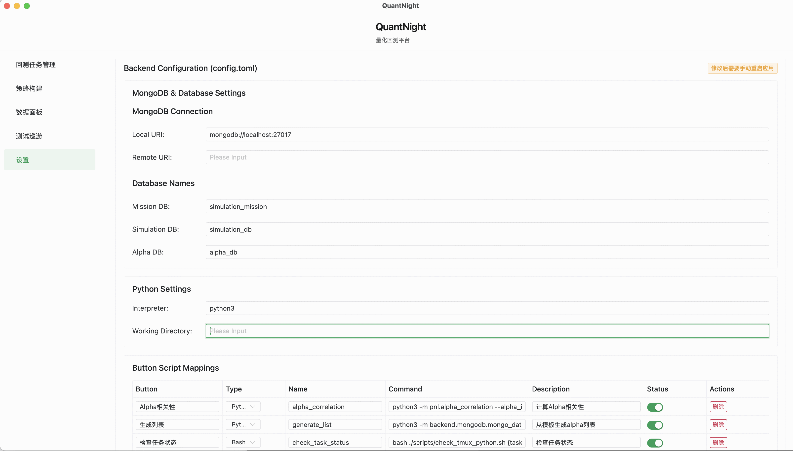

# QuantNight

[中文](README.md) · [Download](https://github.com/roshameow/quantnight-frontend/releases/latest) · [User guide](docs/user-guide.en.md)

A desktop console for quantitative research: manage regular, Priority and SUPER tasks, track local and remote execution, and explore results.



## Try the interface

Requires Node.js 22 or later. The interactive demo uses synthetic data and needs no database, platform account or backend:

```bash
git clone https://github.com/roshameow/quantnight-frontend.git
cd quantnight-frontend
npm ci
npm run demo
```

Open `/demo.html` at the address printed in the terminal. Browse task cards, toggle local/remote labels and filter sample results. Start, pause and delete change in-memory demo data only; refreshing resets it. No real simulations are started.

## Scope

- **Standalone demo**: browse and interact with sample tasks without other services.
- **Desktop application**: manage tasks, configure execution parameters and explore results stored in your database.
- **Real task execution**: requires a compatible private `quantnight` backend, MongoDB, script mappings and your own platform account. The backend is not included in this repository or the desktop download.

Demo results are fictional, not actual backtest performance.

## Desktop installation and configuration

Download an installer for your system from [Releases](https://github.com/roshameow/quantnight-frontend/releases/latest). If you have a compatible backend, follow the [user guide](docs/user-guide.en.md) for database setup, task management and data views.

Connection setup for the current source:

1. Set `env.working_dir` in the application TOML to your backend root, and configure database/collection names and script mappings. See the [bundled configuration template](src-tauri/resources/config.toml).
2. Configure `mongodb.local_uri`, `mongodb.remote_uri` and your platform account in that backend's private `credentials.yaml`. Desktop connections use the backend configuration, not the legacy URI fields in TOML. Task database names must match the backend binding; runtime task pools initialize roles on demand, while the original non-task GUI pool retains its configuration requirements.
3. Reopen for original non-task GUI data configuration changes. Task-host endpoint/shared-source changes require explicit [build and safe adoption](crates/taskctl/README.md#runtime-enrollment-and-safe-adoption); reopening only the GUI does not replace the host. The template picker selects existing backend templates, not uploads. Place templates in the execution environment first.

After explicit macOS runtime enrollment, GUI and CLI are equal clients of one
independent headless taskctl task host. The Python entry directly execs the
registered independent runtime program as a client, without GUI files/ready.
Launchd socket activation starts the host on first demand; closing GUI does not
stop it or the runner. Non-task Alpha/data/PNL retains the original GUI pool;
unenrolled schema 1 keeps the old mode. This is the source contract, not proof
that a download or this machine is enrolled/loaded.

For GUI task diagnostics, explicitly select the original AppConfig through the
single build/adoption guide so the host retains the original task-script contract;
pure CLI backend_root mode does not invent GUI script defaults.

Once connected, add a task, select its template and configure its parameters. Use task cards to start or pause execution and the data page to filter results. Pausing local execution does not cancel simulations already accepted by the platform.

## Source development

Requires Node.js 22+, Rust and the [Tauri system prerequisites](https://v2.tauri.app/start/prerequisites/). Desktop development also needs a compatible backend and the configuration above. First register your frontend/backend paths using the [CLI/task-host build and explicit adoption guide](crates/taskctl/README.md#runtime-enrollment-and-safe-adoption), then run:

```bash
npm ci
npm run tauri:dev
```

To try only the interface, use `npm run demo`; no registration or real host is
started. The Tauri development command above only manages the GUI; it does not
automatically build/install/upgrade the task host. UI-only changes must not force
host restart.

## Documentation and feedback

- [User guide](docs/user-guide.en.md): initial setup, tasks and data analysis.
- [Developer architecture](docs/architecture.en.md): data flow, local/remote execution and script interfaces.
- [CLI usage guide (中文)](docs/cli-usage.md): 16 business commands, invocation, arguments and workflows; host management belongs to the build guide.
- [CLI build and development binding](crates/taskctl/README.md): independent CLI/task host, configuration selection, explicit enrollment and safe drain/adoption.
- [Changelog](CHANGELOG.md) · [Report an issue](https://github.com/roshameow/quantnight-frontend/issues) with your version, OS, reproduction steps and redacted logs.

## License

[MIT](LICENSE)
