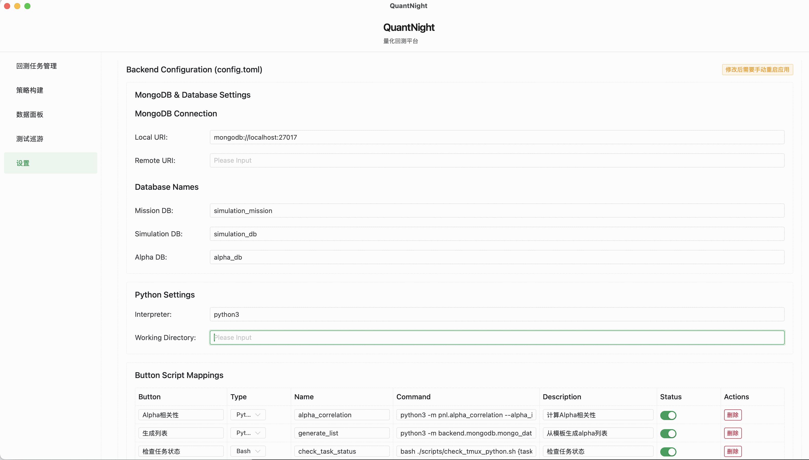

# QuantNight

[English](README.en.md) · [下载安装包](https://github.com/roshameow/quantnight-frontend/releases/latest) · [使用指南](docs/user-guide.zh.md)

量化研究任务的桌面控制台：管理普通、Priority 和 SUPER 任务，查看本地与远程执行进度，筛选研究结果。



## 先体验

需要 Node.js 22 或更新版本。交互演示使用合成数据，无需数据库、平台账号或后端：

```bash
git clone https://github.com/roshameow/quantnight-frontend.git
cd quantnight-frontend
npm ci
npm run demo
```

打开终端给出的地址，在 `/demo.html` 查看任务卡片、切换本地/远程标记、筛选示例结果。启动、暂停、删除仅修改演示内存数据，刷新后重置，不会发起真实模拟。

## 可用范围

- **独立演示**：浏览和操作示例任务，无需其他服务。
- **桌面应用**：管理任务、配置执行参数、查看数据库中的研究结果。
- **真实任务执行**：需要兼容的私有 `quantnight` 后端、MongoDB、脚本映射和用户自己的平台账号。后端未包含在本仓库或安装包中。

演示结果为虚构数据，不代表实际回测表现。

## 桌面安装与配置

从 [Releases](https://github.com/roshameow/quantnight-frontend/releases/latest) 下载适合系统的安装包。已有兼容后端的用户，请按[使用指南](docs/user-guide.zh.md)配置数据库、任务和数据页面。

当前源码的连接配置要点：

1. 在应用 TOML 中将 `env.working_dir` 设为后端根目录，并配置数据库/集合名称与脚本映射；可参考[内置配置模板](src-tauri/resources/config.toml)。
2. 在该后端的私有 `credentials.yaml` 中配置 `mongodb.local_uri` 和 `mongodb.remote_uri`，以及平台账号。桌面连接读取后端配置，不使用 TOML 中的旧 URI 字段；两种数据库角色均需配置，任务数据库名称须与后端一致。
3. 更改连接配置后，关闭并重新打开应用。模板选择器关联后端已有模板，不上传文件；请先将模板放到对应执行环境。

连接后，在任务页添加任务、选择模板并配置参数；通过任务卡片启动或暂停，在数据页筛选结果。暂停本地执行不等于取消平台已接受的模拟。

## 源码开发

需要 Node.js 22+、Rust 和 [Tauri 系统依赖](https://v2.tauri.app/start/prerequisites/)。桌面开发还需兼容后端及上述配置；先按 [CLI 开发配置指南](crates/taskctl/README.md#explicit-desktop-development-taskctl-mode)登记前后端路径，再运行：

```bash
npm ci
npm run tauri:dev
```

仅体验界面请使用 `npm run demo`，无需桌面开发登记。

## 文档与反馈

- [用户指南](docs/user-guide.zh.md)：首次配置、任务管理与数据分析。
- [开发架构](docs/architecture.zh.md)：数据流、本地/远程执行与脚本接口。
- [命令行工具](crates/taskctl/README.md)：构建、配置与使用。
- [版本记录](CHANGELOG.md) · [问题反馈](https://github.com/roshameow/quantnight-frontend/issues)（请附版本、系统、复现步骤及脱敏日志）。

## 许可

[MIT](LICENSE)
