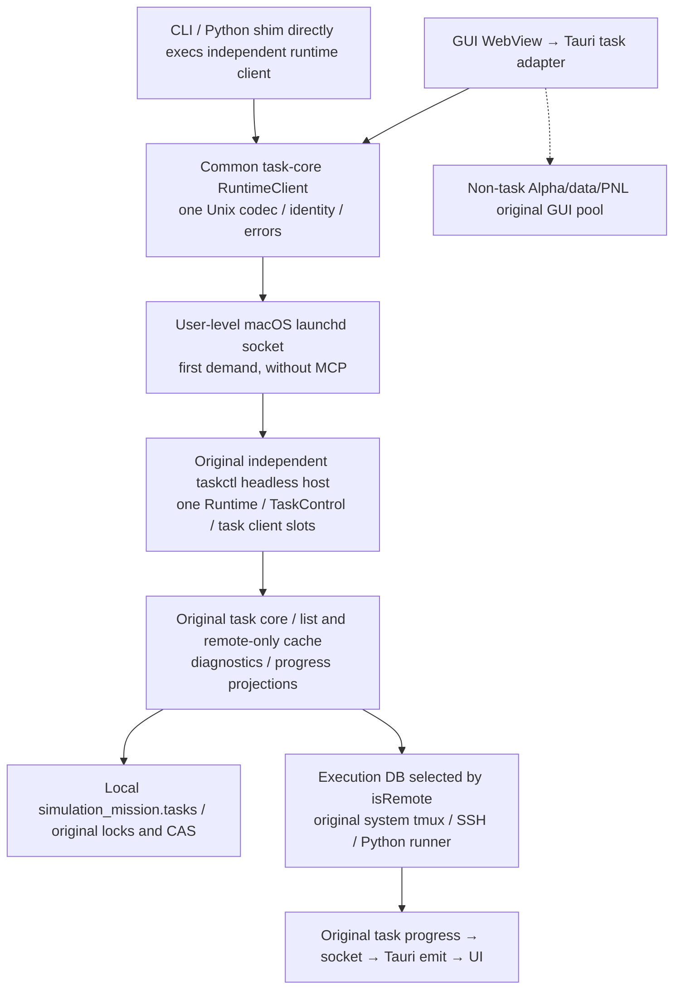

## System Architecture

> ⚠️ **The most important section for developers/agents.** Quantitative backtesting is a **state-driven distributed system**: the UI is decoupled from execution, and data flows across databases. **"Local/Remote" is NOT a fixed machine — it is a concept configured through Settings.** Any deployment shape (single machine, dual machine, remote) is expressed via configuration. Never hardcode machine names or paths.

This describes the explicitly runtime-enrolled source contract, not installation
or loaded adoption. Schema 1 without runtime enrollment keeps the original mode.
See the [single build/adoption guide](../crates/taskctl/README.md#runtime-enrollment-and-safe-adoption)
and [CLI reference](cli-usage.md).

### 1. Configuration-Driven "Local/Remote" Model

| Config Key | Location | Meaning |
|---|---|---|
| `mongodb.local_uri` | Original backend MongoConfig / private credentials.yaml | Local role; legacy TOML URI fields are not transport authority |
| `mongodb.remote_uri` | Original backend MongoConfig / private credentials.yaml | Remote role; tunnel/port depends on actual deployment, not a fixed machine identity |
| `env.working_dir` | Settings / config.toml | Working directory for backend Python scripts |
| `scripts.local_workdir` | credentials.yaml | Local working directory |
| `scripts.remote_host` / `remote_workdir` | credentials.yaml | Remote execution host and directory |

- Single-machine: `remote_uri` points to the local host or empty; `isRemote` stays `false`.
- Dual-machine (recommended): the desktop app handles UI/task management; an execution machine (e.g. mac-mini) runs Python backtests; `remote_uri` / `remote_host` point to it.

A runtime selector may explicitly select the original canonical AppConfig TOML:
original loader → resolve_gui_binding → MongoConfig. Backend/task namespaces and
the original check_task_status descriptor must match the host; no full config/URI
is sent over IPC. backend_root remains pure CLI, without invented GUI scripts.
Non-task Alpha/data/PNL/UI changes are outside task-settings compatibility. An
executable-only schema 2 upgrade retains its selector; stop/drain the old binding
before publishing a changed selector. Candidate/deployment commands belong only
to the single taskctl guide.

### 2. Dual-Database Model

After runtime enrollment, the **task host** owns shared lazy client slots from the
original Mongo factory, initialized once per requested local/remote role and shared
by task core, queries, diagnostics and progress. The old GUI already reused Arc
clients; this is not a per-button reconnect fix. Non-task Alpha/data/PNL/correlation
retains its independent GUI data pool and namespace settings. Tasks route by
`isRemote`; original MongoConfig remains endpoint authority:

| Database | Content | Read/Write Location |
|---|---|---|
| `simulation_mission.tasks` | Task config & status (**single source of truth**) | **Always local DB** |
| `simulation_db.<task>` | Simulation items (settings/regular/feat/results) | Dispatched by `isRemote`: local or remote DB |
| `alpha_db` | Core alpha results / PnL / platform data | Local DB |

### 3. Task Data Flow

1. **Create/generate** keep original core/template/writer ownership. Candidates
   start in the local collection; configuration/types/provenance and generation
   tokens remain unchanged.
2. **Initial sync/start** keep original identity, insert-only/digest, launch/CAS
   and system tmux/SSH ownership. GUI does not run raw sync or write isRemote;
   existing receipts are not migrated.
3. **Task queries/progress** also belong to the host: retain local precedence,
   remote-only display/cache, generation reconciliation, full Priority/root/
   source_remote data, monotonic event versions and error semantics. Diagnostics
   is not status; list/status may perform original lifecycle reconciliation writes.
4. **Simulation/results/notifications** keep original Python runner/API/business
   writer/recovery/notification owners. The host is not MCP, a remote daemon or
   another simulation queue.
5. **Lifecycle**: closing GUI does not stop host/runner. No KeepAlive/RunAtLoad or
   automatic idle exit; crash recovery on next socket demand restores the listener,
   not old calls. From first Call write, disconnect never authorizes resend or
   direct fallback. Only in-memory inflight/JoinHandles, no transport ledger or
   result copy; reconcile original business receipts.
6. **Adoption**: task configuration/shared-source changes require explicit build/
   enrollment and safe drain/adoption by the original owner. GUI reload does not
   upgrade the host; UI-only edits must not force host restart. Each image's loaded
   UUID is verified against its own executable, not against the other image.

### 4. Frontend Data Source Cheat-Sheet (for agents debugging)

| UI Content | Command / Mechanism | DB Read |
|---|---|---|
| Task list / status | Tauri get_all_tasks → common client → host task query | Original local control plane; remote-only display/cache, local precedence |
| Task card ✓/✗/Σ progress | Host task_progress subscription → common socket → Tauri emit | Original isRemote/source_remote and Priority/root routing |
| Data analysis (Data page) | `datas.rs` queries | Local `simulation_db` / `alpha_db` |
| isRemote / sync | GUI adapter → original core sync/binding checks | No raw field write or bypass of stop/receipt guards |

### 5. `isRemote` Semantics

- `false` (local): data in local DB; Python executes locally.
- `true` (remote): data synced to remote DB; Python executes remotely (SSH).
- ⚠️ `isRemote` is not an arbitrary migration switch. Original core checks identity,
  stop/receipts and digest before initial sync/marking. Do not edit the field or
  run raw sync to overwrite existing results.

### 6. Script Execution Model

Task button → Tauri argument/receipt/event adapter → the same Unix client as CLI
→ headless host's sole dispatcher → original task-core locks/CAS → original
scripts/professional Python owners. Local/SSH execution stays unchanged. WebView
invoke is not external CLI IPC. Non-task data/file/UI functions retain their
original GUI implementation.

The 10-second connect/Hello budget covers startup only. Original 30-second
per-read-stage, 8-second write and 900-second generate budgets remain; no total
30-second command deadline or full-export cap. Pool reuse does not prove MongoDB
latency root causes fixed. Protocol/types belong to shared runtime source, not a
second GUI schema. Detailed lifecycle semantics remain in the compatible backend's
`docs/task_control_lifecycle.md`.
