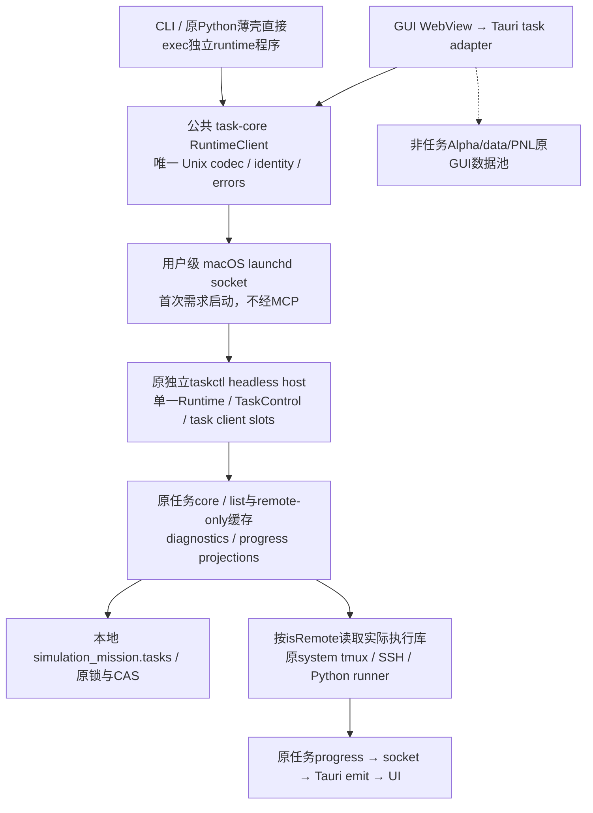

## 系统架构

> ⚠️ **对开发者/Agent 最重要的一节**。量化回测是**状态驱动**的分布式系统：UI 与执行解耦，数据跨库流动。**"本地/远程"不是固定的机器，而是由设置（Settings）配置出来的概念**——任何部署形态（单机、双机、异地）都通过配置表达，不要硬编码任何机器名/路径。

本文描述明确runtime登记后的源码合同，不是安装/运行采用证明；schema1未启用时保留原模式。构建与采用只见[taskctl手册](../crates/taskctl/README.md#runtime-enrollment-and-safe-adoption)，业务命令只见[CLI使用手册](cli-usage.md)。

### 1. 配置驱动的"本地/远程"模型

| 配置项 | 位置 | 含义 |
|---|---|---|
| `mongodb.local_uri` | 后端原MongoConfig / 私有credentials.yaml | local角色连接；TOML旧URI字段不是transport权威 |
| `mongodb.remote_uri` | 后端原MongoConfig / 私有credentials.yaml | remote角色连接；隧道/端口依实际部署，不固定机器身份 |
| `env.working_dir` | Settings / config.toml | 后端 Python 脚本的工作目录 |
| `scripts.local_workdir` | credentials.yaml | 本地工作目录 |
| `scripts.remote_host` / `remote_workdir` | credentials.yaml | 远程执行主机与目录 |

- 单机部署：`remote_uri` 指向本机或留空，`isRemote` 永远 false。
- 双机部署（推荐）：桌面端负责 UI/任务管理，执行机（如 mac-mini）跑 Python 回测，`remote_uri` / `remote_host` 指向它。

runtime配置selector可选明确的原AppConfig TOML：原loader→resolve_gui_binding→MongoConfig，任务namespace/root与原check_task_status脚本descriptor必须兼容host；不经IPC传全配置/URI。backend_root仍为纯CLI模式，不伪造GUI脚本。非任务Alpha/data/PNL/UI变更不纳入task-settings门；schema2无显式cfg升级保留既有selector，变更前先旧binding安全stop/drain再publish。具体候选/部署命令只见唯一taskctl手册。

### 2. 双数据库模型

runtime登记后，**任务host**持有原Mongo工厂的共享lazy client slots，本地/远端按实际需要初始化一次，任务core/查询/诊断/进度共用；GUI原本已复用Arc池，本轮不是修每按钮重连。GUI非任务Alpha/data/PNL/correlation仍保留原独立数据池，不强制其namespace等于backend默认值。task按 `isRemote` 分流，连接来源始终由原MongoConfig核验：

| 数据库 | 内容 | 读写位置 |
|---|---|---|
| `simulation_mission.tasks` | 任务配置与状态（**唯一权威来源**）| **永远在本地库** |
| `simulation_db.<task>` | 模拟 item 数据（settings/regular/feat/结果）| 按 `isRemote` 分流：本地库 或 远程库 |
| `alpha_db` | 核心 Alpha 结果 / PnL / 平台数据 | 本地库 |

### 3. 任务数据流

1. **创建/生成**由原core与模板/writer owner完成；候选始终先写本地集合，完整配置/类型/来源及generation token不变。
2. **初始远程同步/启动**沿原core的身份、insert-only/digest、launch/CAS与系统tmux/SSH owner；GUI不直接调用裸同步或改isRemote，不迁移已有回执。
3. **任务查询/进度**也在host：保留本地优先/remote-only展示与原缓存、generation核验、完整Priority/root/source_remote、单调事件版本和错误语义。诊断不是status的别名；list/status可能沿原生命周期核验写回，不能都称纯读。
4. **回测/结果/通知**仍由原Python runner/API/业务writer/recovery/通知owner负责；公共host不是MCP、远程daemon或新模拟队列。
5. **生命周期**：关闭GUI不关闭host/runner；host无KeepAlive/RunAtLoad和自动idle exit，crash后下一socket需求只恢复listener，不重放调用。已开始写Call后断线不自动重连重投/退直连；host只持内存inflight/JoinHandle，没有transport账本或结果副本，核原业务回执。
6. **采用**：任务配置/共享源码变动需原owner明确build/登记、drain旧host收尾后安全采用；GUI-only热重载不证明host更新，UI-only变更不强制host重启。host和GUI各自核loaded UUID，不要求两个image UUID相等。

### 4. 前端数据来源速查（agent 排查问题用）

| UI 内容 | 命令 / 机制 | 读取库 |
|---|---|---|
| 任务列表 / 状态 | Tauri `get_all_tasks` → 公共client → host任务查询 | 原本地控制面；remote-only缓存仅展示，本地优先 |
| 任务卡片 ✓/✗/Σ 进度 | host共享task_progress订阅 → 同一socket → Tauri emit | 原按isRemote/source_remote与Priority/root规则选库 |
| 数据分析（Data 页）| `datas.rs` 各查询 | 本地库 `simulation_db` / `alpha_db` |
| isRemote / 同步 | GUI适配 → 原task-core同步/绑定校验 | 禁止裸改标记或绕过原停止/回执保护 |

### 5. isRemote 字段语义

- `false`（本地）：数据在本地库，Python 在本地执行。
- `true`（远程）：数据已同步到远程库，Python 在远程执行（SSH）。
- ⚠️ `isRemote`不是任意迁移开关。初始同步/标记由原core核身份、停止/回执与digest后完成；不手工改字段或裸执行同步覆盖已有结果。

### 6. 脚本执行模型

任务按钮 → Tauri参数/回执/事件适配 → 与CLI相同的公共Unix client → headless host唯一dispatcher → 原task-core锁/CAS → 原脚本/专业Python owner。本机或SSH执行规则不变；WebView invoke不是外部CLI IPC。非任务数据/文件/UI功能保留原GUI实现。

connect/Hello的10秒仅启动预算；原短读每阶段30秒、写8秒、generate900秒等保留，不设置全命令30秒deadline或完整导出总量cap。复用池不等于Mongo迟滞根因已解决。协议/类型以公共runtime源码为准，不在GUI文档复制schema；后端详细生命周期由兼容backend的 `docs/task_control_lifecycle.md` 单点维护。
